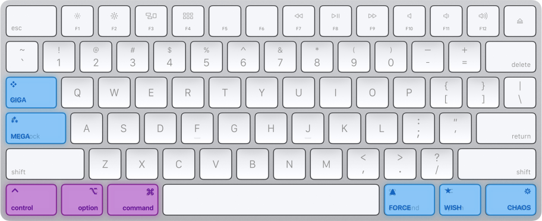

# Modifier guide

MegaKey names five combinations of ordinary modifiers. You can press the modifiers yourself or use the supplied macOS rules to put each combination on one key.



## Mega and Giga

- Mega is a pseudo-key, not a physical key. It means <kbd>Ctrl</kbd>+<kbd>Opt</kbd>+<kbd>Cmd</kbd>.
- ⁂ represents the three modifiers. The name plays on "Meh" ("Meh"-ga), a name used for modifier combinations in other setups.
- Hold <kbd>Caps Lock</kbd> for Mega with its Karabiner rule enabled.
- Giga is Shift+Mega: <kbd>Shift</kbd>+<kbd>Ctrl</kbd>+<kbd>Opt</kbd>+<kbd>Cmd</kbd>. Its symbol, ❖, represents four modifiers.
- Think SI prefixes: Mega, then Giga. Hold <kbd>Tab</kbd> for Giga, or use <kbd>Shift</kbd>+<kbd>Caps Lock</kbd>.

```text
                         ❖ Giga
                        +Shift
                           ^
                           |
  ⭑ Wish <-------------- ⁂ Mega --------------> ❋ Chaos
  -Command                 |                   -Control
                           v
                         ▲ Force
                        -Option
```

The four variations of Mega each add or remove one modifier. <kbd>Tab</kbd> still sends <kbd>Tab</kbd> when tapped alone; <kbd>Caps Lock</kbd> sends <kbd>Caps Lock</kbd> or <kbd>Esc</kbd>, depending on the file you chose.

## The three "anti" keys

Each anti key is Mega with one modifier removed. Each also has a shifted version: `Wish` and `Shift+Wish` are distinct, while `Shift+Mega` is already Giga. Adding Shift to Giga leaves the same four-modifier combination.

### Chaos

- The "anti-Control" key: Mega minus Control, or <kbd>Opt</kbd>+<kbd>Cmd</kbd>.
- Hold <kbd>Right Ctrl</kbd> for Chaos.
- Chaos is "uncontrolled." Its symbol, ❋, resembles a [Chaos Star](https://en.wikipedia.org/wiki/Symbol_of_Chaos).

### Force

- The "anti-Option" key: Mega minus Option, or <kbd>Ctrl</kbd>+<kbd>Cmd</kbd>.
- Hold <kbd>Right Option</kbd> for Force.
- Force leaves no option. The triangle, ▲, recalls the [Triforce](https://en.wikipedia.org/wiki/Triforce).

### Wish

- The "anti-Command" key: Mega minus Command, or <kbd>Ctrl</kbd>+<kbd>Opt</kbd>.
- Hold <kbd>Right Cmd</kbd> for Wish.
- "Your wish is my command." A wish is a softer command; ⭑ is for wishing upon a star.

Enable each rule separately; an enabled right modifier rule replaces that key's original function.

| Symbol | Name | Physical key (hold) | Equivalent keys | ⇧ | ⌃ | ⌥ | ⌘ | Relation to Mega |
|:------:|------|---------------------|-----------------|---|---|---|---|------------------|
| ⁂ | Mega | <kbd>Caps Lock</kbd> | <kbd>Ctrl</kbd>+<kbd>Opt</kbd>+<kbd>Cmd</kbd> | | ⌃ | ⌥ | ⌘ | Base combination |
| ❖ | Giga | <kbd>Tab</kbd> | <kbd>Shift</kbd>+<kbd>Ctrl</kbd>+<kbd>Opt</kbd>+<kbd>Cmd</kbd> | ⇧ | ⌃ | ⌥ | ⌘ | Add Shift |
| ❋ | Chaos | <kbd>Right Ctrl</kbd> | <kbd>Opt</kbd>+<kbd>Cmd</kbd> | | | ⌥ | ⌘ | Remove Control |
| ▲ | Force | <kbd>Right Option</kbd> | <kbd>Ctrl</kbd>+<kbd>Cmd</kbd> | | ⌃ | | ⌘ | Remove Option |
| ⭑ | Wish | <kbd>Right Cmd</kbd> | <kbd>Ctrl</kbd>+<kbd>Opt</kbd> | | ⌃ | ⌥ | | Remove Command |

The [behavior reference](etc) covers taps, shifted combinations, and the optional clipboard demo. See also [useful shortcuts in apps](shortcuts).

## Relation to Hyper and Meh

Hyper and Meh are established names for multi-modifier mappings, but usage varies between setups. Hyper often means all four modifiers, the combination MegaKey calls Giga. MegaKey uses explicit definitions for five related combinations; it does not require you to replace a working Hyper setup or use a new remapping engine.

For shortcuts, write `Giga+C` or `❖C` instead of `Shift+Control+Option+Command+C`. These names do not assign actions by themselves. You still need to bind shortcuts in an app or enable a rule such as the optional clipboard demo.

## Names on Windows and Linux

The naming concept can be carried to Windows or Linux using Control, Win/Super, and Alt. This repository supplies no remapping software for those platforms. The following is a naming proposal, not an installable configuration.

- "Sub" is the opposite of Super; "Main" is the opposite of Alt (alternate).
- Write `Sub.Force` and `Main.Wish`, or shorten them to `Sub` and `Main`. The symbols stay the same.

```text
                         ❖ Giga
                        +Shift
                           ^
                           |
  ⭑ Main <-------------- ⁂ Mega --------------> ❋ Chaos
  -Alt                     |                   -Control
                           v
                         ▲ Sub
                       -Win/Super
```

| Symbol | macOS name and combination | Windows/Linux name and combination | Omitted key |
|:------:|----------------------------|------------------------------------|-------------|
| ⁂ | Mega: <kbd>Ctrl</kbd>+<kbd>Opt</kbd>+<kbd>Cmd</kbd> | Mega: <kbd>Ctrl</kbd>+<kbd>Win/Super</kbd>+<kbd>Alt</kbd> | None |
| ❖ | Giga: <kbd>Shift</kbd>+<kbd>Ctrl</kbd>+<kbd>Opt</kbd>+<kbd>Cmd</kbd> | Giga: <kbd>Shift</kbd>+<kbd>Ctrl</kbd>+<kbd>Win/Super</kbd>+<kbd>Alt</kbd> | None; add Shift |
| ❋ | Chaos: <kbd>Opt</kbd>+<kbd>Cmd</kbd> | Chaos: <kbd>Win/Super</kbd>+<kbd>Alt</kbd> | Control |
| ▲ | Force: <kbd>Ctrl</kbd>+<kbd>Cmd</kbd> | Sub.Force: <kbd>Ctrl</kbd>+<kbd>Alt</kbd> | Option / Win/Super |
| ⭑ | Wish: <kbd>Ctrl</kbd>+<kbd>Opt</kbd> | Main.Wish: <kbd>Ctrl</kbd>+<kbd>Win/Super</kbd> | Command / Alt |

## Related work

The [Space-cadet keyboard](https://en.wikipedia.org/wiki/Space-cadet_keyboard) had a physical Hyper key. Modern remapping tools bring similar combinations to ordinary keyboards. Examples and discussions include:

- [Raycast's Hyper key](https://manual.raycast.com/hyper-key)
- [Ben Davis's Karabiner setup](https://www.davis7.sh/karabiner)
- [Meh and Hyper for normal keyboards](https://kevinkipp.com/blog/meh-and-hyper-for-normal-keyboards/)
- [How to get your very own Hyper key](https://zenmushie.medium.com/how-to-get-your-very-own-hyper-key-0c91ed4a84ff)
- [Remapping Caps Lock to Hyper](https://juleslibert.com/en/thoughts/remapping-capslock-to-hyperkey)
